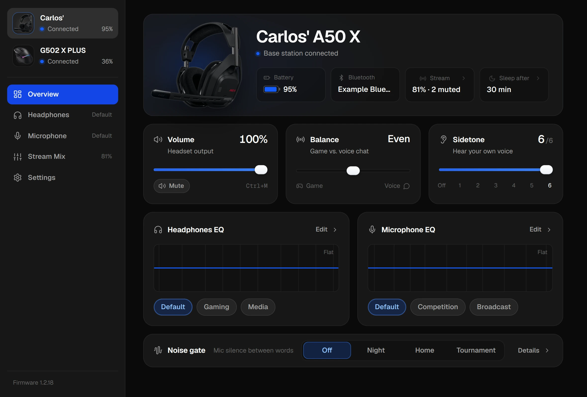
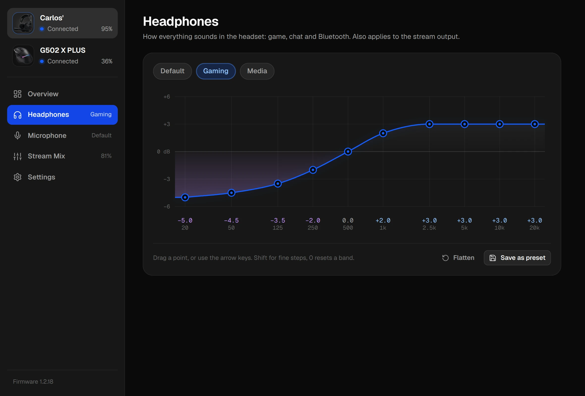
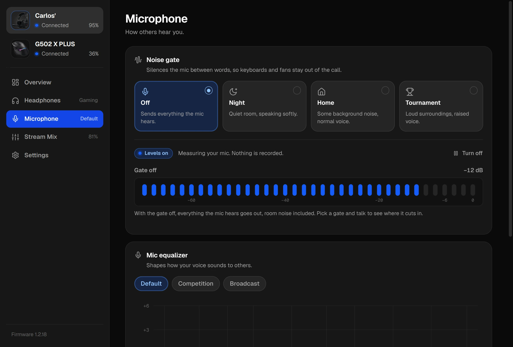
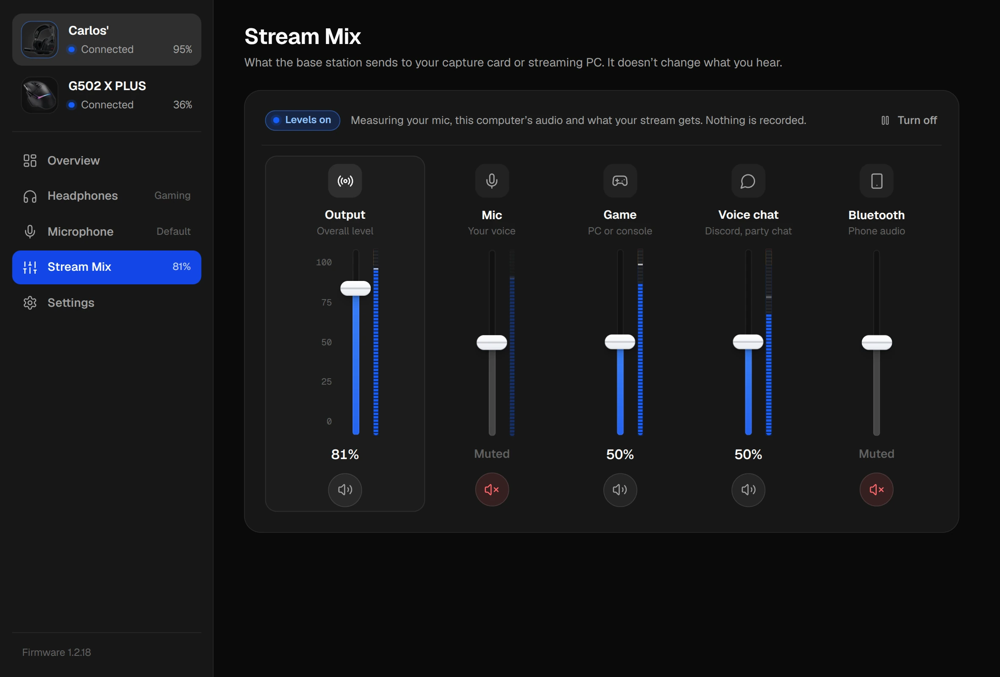
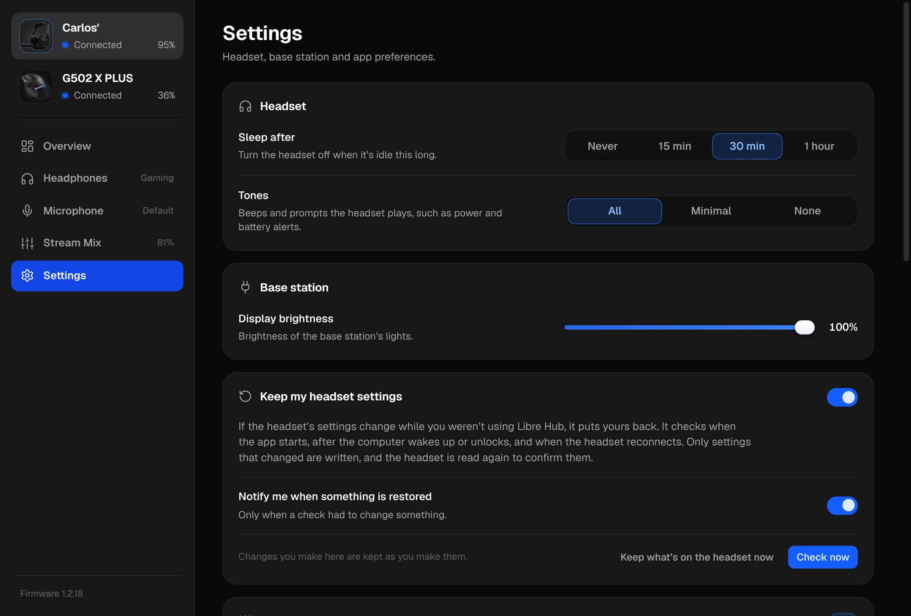
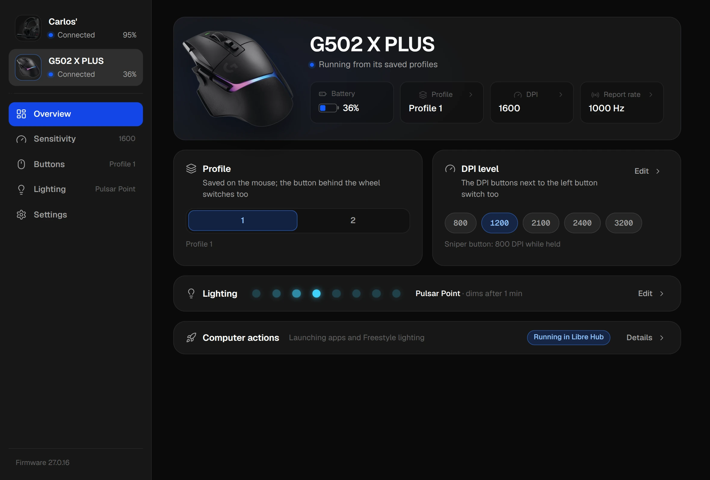
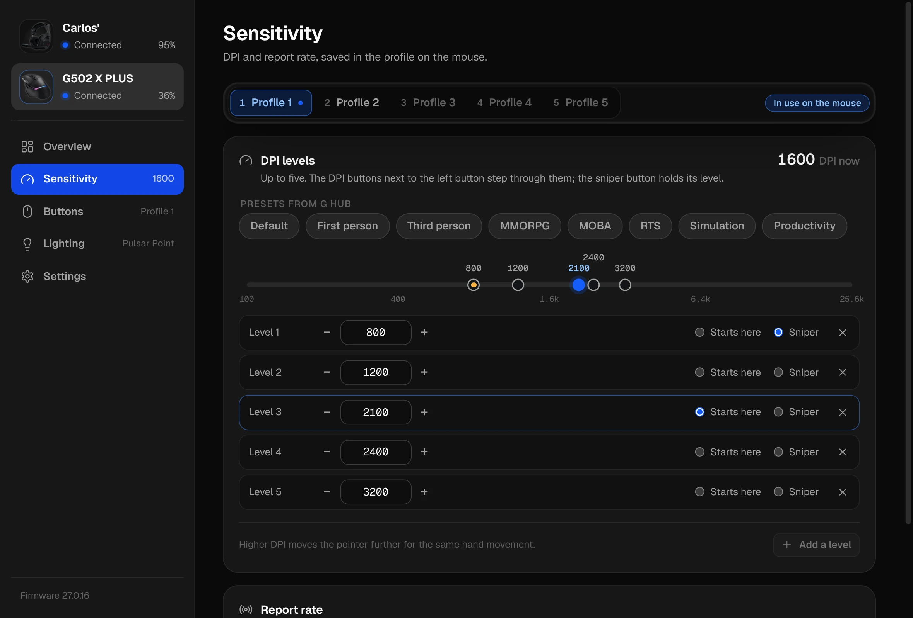
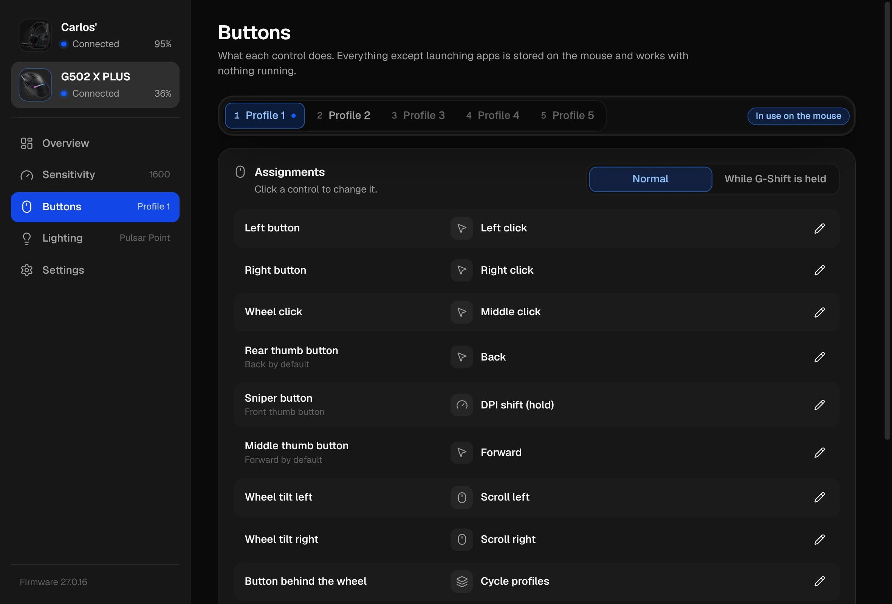
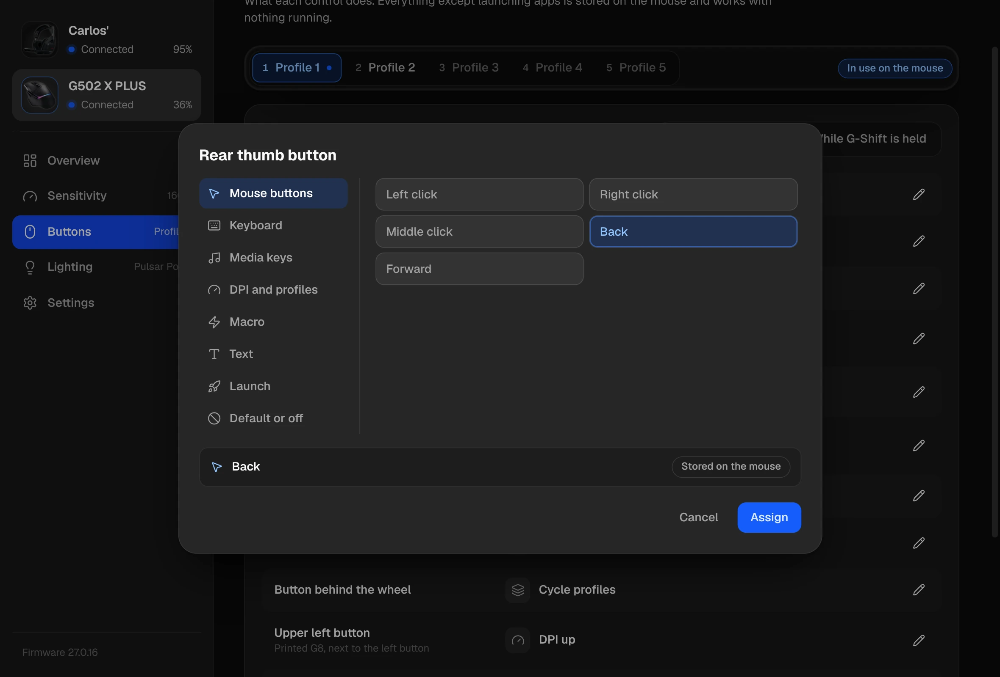
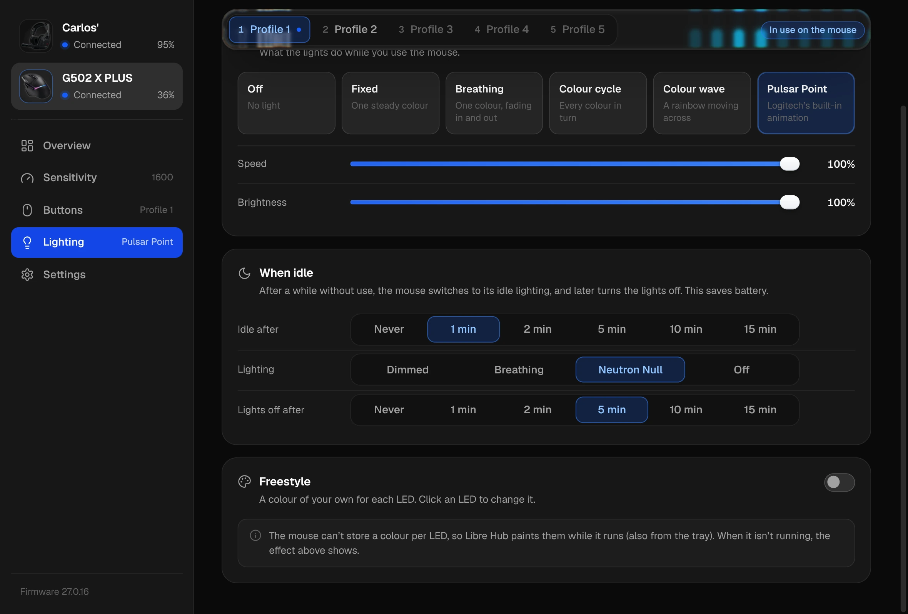

# LibreHub

Control Logitech gear without G Hub: the **A50 X** headset and the **G502 X PLUS** mouse, from
one desktop app, **Libre Hub**, or one command, `librehub`. The AppImage has only the app; the
command comes with a [build from source](#build-from-source-linux).
The goal is Linux, where G Hub doesn't exist. Everything here also runs on macOS. The A50 X has
been verified against the real headset on both platforms, the G502 X PLUS on macOS.

<picture>
  <source media="(prefers-color-scheme: light)" srcset="docs/screenshots/a50x-overview-light.webp">
  
</picture>

The protocols were reverse-engineered from G Hub and the devices themselves:

- A50 X: [docs/PROTOCOL.md](docs/PROTOCOL.md)
- G502 X PLUS: [docs/G502X-PROTOCOL.md](docs/G502X-PROTOCOL.md), including a map of every G Hub
  setting to where it lives on the mouse
- How G Hub works and how this was worked out: [docs/GHUB-INTERNALS.md](docs/GHUB-INTERNALS.md)

## A50 X: what it controls

| Setting | G Hub equivalent | Status |
|---|---|---|
| Sidetone (7 steps) | Settings → Sidetone | ✅ verified on hardware |
| Game ↔ voice balance (0..12) | Settings → Balance | ✅ verified on hardware |
| Device volume (0..21) and mute | Settings → Device Volume | ✅ verified on hardware |
| Sleep after (never / 15 / 30 / 60 min) | Settings → Power Management | ✅ verified, byte-identical to G Hub |
| Base station brightness (0..100) | Settings → Base Station Brightness | ✅ verified on hardware |
| Headset tones (none / all / minimal) | Settings → Tones | ✅ verified on hardware |
| Mic noise gate (off / home / night / tournament) | Microphone → Noise Gate | ✅ verified on hardware |
| Stream-port mix: output level/mute, mic / game / bluetooth / voice levels and mutes | Routing | ✅ verified on hardware |
| Headphones EQ: curated Default / Gaming / Media, custom presets, 10 bands | Headphones → Equalizer | ✅ verified on hardware |
| Mic EQ: curated Default / Competition / Broadcast, custom presets, 10 bands | Microphone → Equalizer | ✅ verified on hardware |
| Battery, firmware, serial, name, paired Bluetooth host | Settings | ✅ read-only |

**Mic volume:** G Hub has no mic-gain control for the A50 X. The mic level it exposes is
"Mic Out" in the stream-port mix (covered above). The level your apps record at is the
normal system input volume (PipeWire/PulseAudio/ALSA on Linux).

**Not covered:** renaming the headset, firmware updates, factory reset, mic test, and the
"EU power mode" capability, which G Hub lists but doesn't implement for this device.

## The app

The sidebar lists both devices; pick one to see its pages. Each shows whether it's connected and
its battery. The tray menu shows both batteries too.

### A50 X

- **Overview:** battery, Bluetooth, volume and mute (`Ctrl+M`), game/voice balance, sidetone,
  and one-click EQ presets and noise gate.
- **Headphones / Microphone:** a 10-band EQ you draw on directly. Drag a point, or focus it
  and use the arrow keys (Shift for 0.1 dB steps, double-click resets a band). Save curves as
  presets; deleting one can be undone.
- **Stream Mix:** a channel strip per source (mic, game, voice chat, Bluetooth) plus the
  output level, i.e. what the base station sends to a capture card or streaming PC. On Linux,
  with game and chat audio split, each strip has a live level meter (see below).
- **Settings:** sleep timer, headset tones, base station brightness, keeping your settings,
  start at login, appearance (light, dark or the system's, and clear or tinted glass) and device
  details.

| | |
|---|---|
|  |  |
| **Headphones:** draw the EQ, or pick a preset | **Microphone:** noise gate with the live mic level |
|  |  |
| **Stream Mix:** what your stream gets, metered live | **Settings:** the headset, the base station and the app |

Every change applies immediately and is stored on the headset. Changes made on the headset
itself (such as its volume wheel) show up in the app as they happen. If the app can't reach
the headset it says why: base station not plugged in, no permission (with a button that allows
access, see below), or the headset not answering. `Ctrl+1`…`Ctrl+5` switch pages.

### G502 X PLUS

- **Overview:** battery, the active profile and DPI level (switch either with one click), the
  lighting at a glance, and whether computer actions are running. If G Hub left the mouse in
  software mode, a banner puts it back on its saved profiles.
- **Sensitivity:** up to five DPI levels (100–25600 in steps of 50), which one the profile starts
  at and which one the sniper button holds, G Hub's DPI presets, and the report rate.
- **Buttons:** what each of the 13 controls does, on the normal layer and while G-Shift is held:
  mouse buttons, keys and key combinations (press them to record them), media keys, DPI and
  profile functions, macros (typed, or recorded from your keyboard), text, double click, opening
  an app, file or website, running a command, default or disabled.
- **Lighting:** the effect (fixed, breathing, colour cycle, colour wave, Pulsar Point, off) with
  its colour, speed, brightness and direction; what happens when idle (dimmed, breathing, Neutron
  Null or off) and when; and Freestyle, a colour per LED.
- **Settings:** the five profiles (switch, enable, rename, restore factory settings), on-board
  memory mode, the startup effect, whether computer actions are running, backup and restore of
  the mouse's whole memory, and device details.

| | |
|---|---|
|  |  |
| **Overview:** profile, DPI level and lighting at a glance | **Sensitivity:** DPI levels, G Hub's presets, report rate |
|  |  |
| **Buttons:** every control, on both layers | **Assigning a button:** keys, macros, text, apps and more |
|  | |
| **Lighting:** effects, idle lighting and Freestyle | |

Sensitivity, Buttons and Lighting edit one profile at a time; tabs at the top pick which. Every
change is written to that profile on the mouse, so it keeps working with nothing running (sliders
write when you let go). The page follows the mouse: switching profile or DPI level with its own
buttons shows up within a couple of seconds. When the mouse sleeps the page dims until you move
it.

## Tray, start at login and keeping your settings

Libre Hub lives in the system tray. The icon shows the battery, and its menu opens the window,
runs a settings check or quits. Closing the window keeps the app running there; to quit,
right-click the tray icon and choose **Quit Libre Hub**. Launching it again just brings the
window back. These options are on the **Settings** page:

- **Keep my headset settings.** If the headset's settings change while you weren't using the
  app (G Hub on Windows was known to reset sidetone and balance at boot), Libre Hub puts yours
  back. It checks when it starts, after the computer wakes, after you unlock (on Linux via
  logind's `LockedHint`), and whenever the headset reconnects. A check reads the headset,
  writes only the settings that differ, then reads again to confirm them. About 20 seconds
  later a follow-up check makes sure they stuck. A desktop notification tells you when
  something had to be restored. Everything is kept: sidetone, balance, volume, both EQs, noise
  gate, stream mix, sleep timer, tones and brightness.
- **Start when you log in.** Starts in the tray without opening the window, like G Hub. On
  Linux this writes an autostart entry in `~/.config/autostart/`, and on macOS a LaunchAgent.
  Both point at this checkout and are refreshed on every launch.

Turning "Keep" on saves what the headset has at that moment. After that, every change you make
in the app or with `librehub headset set` updates the saved settings, as do volume wheel changes while the
app runs. Changes made on the headset while the app isn't running count as drift and get put
back. Saved settings live in `restore.json` next to `presets.json`.

On Linux the app also installs `~/.local/share/applications/com.charlexmachina.LibreHub.desktop`.
That entry is what gives the window its name and icon (the Wayland app id), and it adds Libre Hub
to your application menu.

## Game and chat audio (Linux)

The base station has two playback devices, **Game** and **Voice**, which the headset's
Game/Voice balance mixes. PipeWire's default profile only exposes the Voice one, so on Linux
all desktop audio lands in the chat channel, and sliding the balance toward Game just turns
everything down.

**Settings → Game and chat audio → Split** (or `librehub headset audio setup`) fixes this for your user,
with no root needed:

- **A50 X Game** becomes the default output: games, browser, music.
- **A50 X Voice** gets voice-chat apps automatically: Discord (and Vesktop and similar
  clients), TeamSpeak, Mumble, Signal, Telegram, Zoom and others. Each app is routed the first
  time it plays; if you move it somewhere else in your sound settings, it stays there.
- **A50 X Mic** is the default input. **A50 X Stream Out** is the stream mix, ready to add to OBS.
- Your current volume carries over. Audio cuts out for about a second while WirePlumber
  restarts.

Under the hood it installs `linux/wireplumber/51-logitech-a50x.conf` into
`~/.config/wireplumber/wireplumber.conf.d/` and `logitech-a50x-chat.lua` into
`~/.local/share/wireplumber/scripts/`. The first switches the card to its Pro Audio profile and
names the devices; the second routes chat apps. It needs PipeWire with WirePlumber 0.5 or newer.
**Turn off** (or `librehub headset audio undo`) removes both files and puts the card back on its normal
profile.

### Live levels

With the split on, the app shows live levels, read from the devices above:

- **Stream Mix:** a meter beside each fader. Output reads **A50 X Stream Out**, which is what
  the stream gets. Mic reads **A50 X Mic**. Game and Voice chat read what this computer plays into
  **A50 X Game** and **A50 X Voice**, before the system volume and the strip's fader, so console
  audio doesn't show there. Bluetooth audio never reaches the computer, so it has no meter.
- **Microphone:** the last few seconds of your mic level under the noise-gate choices. A closed
  gate makes the headset send digital silence (measured: about −90 dBFS, against about −60 dBFS of
  room noise with the gate off), so the app can show when the gate is open or closed and stripe
  the silent stretches. G Hub doesn't expose the gate thresholds, so none are drawn; talk and
  compare the settings instead. Digital silence can also mean the mic is muted on the headset.

Levels are measured in the main process with `pw-record` and only the numbers reach the window.
Nothing is recorded or stored. Meters run only while their page is showing and the window is
focused, and **Turn off** keeps them off (on both pages) until you turn them back on. On the
test machine they use about 4% of one CPU core on Stream Mix and 5% on Microphone; nearly all of
it is Chromium drawing 30 frames a second (the desktop's compositor spends about 1% of a core more
showing them). Turned off or in the background they cost nothing, and with nothing moving almost
nothing.

## G502 X PLUS: what it controls

The mouse keeps five profiles in its own memory, and G Hub's "on-board memory mode" runs from
them. Libre Hub and `librehub mouse` edit those profiles directly. Settings take effect at once and stay on the mouse,
with nothing running in the background, which is what you want on Linux.

| Setting | G Hub equivalent | Status |
|---|---|---|
| DPI levels (up to 5, 100–25600 in steps of 50), default level, DPI-shift level | Sensitivity (DPI) | ✅ verified on hardware and by G Hub's own decoder |
| Curated DPI presets (Default, First Person, Third Person, MMORPG, MOBA, RTS, Simulation, Productivity) | G Hub's sensitivity prefabs for this model | ✅ |
| Report rate 125 / 250 / 500 / 1000 Hz | Report rate | ✅ verified on hardware and by G Hub |
| All 13 controls on the default and G-Shift layers: mouse buttons, keys with modifiers, media keys, DPI up/down/cycle/default/shift, profile cycle/next/previous, G-Shift, wheel tilt, scroll, battery level, disable | Assignments | ✅ encodings match G Hub's writes; G Hub decodes ours |
| Macros (keys, combos, pauses, mouse buttons, media keys, wheel), Text, Double Click, stored on the mouse and played by it | Assignments → Macros, Text & Emojis, Double Click | ✅ seen working on the mouse (it typed and double-clicked) |
| Open an app, file or website; run a command (Launch Application, Lock screen, …) | Assignments → System, Launch Application | ✅ seen working, while the agent runs |
| Freestyle: a colour per LED, per profile | LIGHTSYNC → Freestyle | ✅ seen on the mouse, while the agent runs |
| Lighting: off, fixed, cycle, breathing, colour wave (both directions), Pulsar Point; brightness and rate | LIGHTSYNC presets | ✅ byte-identical to G Hub's writes |
| Inactivity lighting (Neutron Null, breathing, dim active effect), start after, all lights off after | Settings → Inactivity lighting | ✅ byte-identical to G Hub's writes |
| Profiles 1–5: switch, enable/disable, name, restore factory settings; current DPI level | On-board memory mode | ✅ verified on hardware |
| On-board vs software mode | On-board memory mode toggle | ✅ verified on hardware |
| Device startup effect | Settings → Device startup effect | ✅ verified on hardware |
| Battery, firmware, serial, wheel ratchet state | Settings | ✅ read-only |
| Backup / restore of the whole onboard memory | (none) | ✅ |

G Hub can't store macros, text or Double Click on this mouse: it plays them from the computer
and writes placeholders to the on-board slots. The mouse can play macros itself, though, so
here they are stored on the mouse and work with nothing running. Opening apps and running
commands, and Freestyle lighting, do need the computer; the **agent** handles them (below).

**Not covered:** emojis and non-ASCII text (the mouse can only send key presses; text uses a
US layout), Screen Sampler and LIGHTSYNC sync, editing the stored animations, G Hub's own
actions, and firmware updates. See
[docs/G502X-PROTOCOL.md](docs/G502X-PROTOCOL.md#macros-software-actions-and-freestyle).

The library also implements G Hub's software-mode calls (live DPI, report rate, lighting
effects, per-LED colours, inactivity timers) for parity, but the CLI works in on-board mode.

## Requirements

- A50 X: the **base station connected over USB.** Settings travel USB → base station →
  Lightspeed → headset. The headset's direct Bluetooth link carries audio only and can't
  be configured.
- G502 X PLUS: its **Lightspeed receiver** (USB 046d:c547), or the mouse on its cable.
- To build from source: Node.js 20+. The repo pins Node 24 for [Volta](https://volta.sh) users.

## Install (Linux)

Download `Libre-Hub-x86_64.AppImage` from the
[latest release](https://github.com/CharlExMachina/LibreHub/releases/latest), put it
somewhere permanent (e.g. `~/Applications`), make it executable and run it:

```bash
chmod +x ~/Applications/Libre-Hub-x86_64.AppImage
~/Applications/Libre-Hub-x86_64.AppImage
```

It doesn't need FUSE 2. On first run it adds Libre Hub to your application menu.

**Device access.** Linux only lets an app open the headset's base station and the mouse's
receiver after you allow it, once. The first time, Libre Hub shows **Allow access**: click it and
your desktop asks for your password (KDE, GNOME and most desktops have this dialog). It installs
one udev rule, `/etc/udev/rules.d/70-libre-hub.rules` (from
[linux/70-libre-hub.rules](linux/70-libre-hub.rules)), and the devices connect right away, with no
replugging. **Settings → Libre Hub → Device access** shows whether it's set up, and updates or
removes it. On a desktop without a password dialog, the app shows the equivalent commands instead.
Under the hood it runs a small helper, `~/.local/share/libre-hub/allow-device-access`, through
`pkexec`; that's the program the password dialog names.

**Updates** install themselves. Libre Hub checks GitHub every few hours, downloads a new
release in the background, and installs it when you quit. To update right away, use
**Restart to update** in the tray menu or in Settings → Libre Hub. Keep the file's name as it is
so updates replace it in place.

## Build from source (Linux)

```bash
git clone git@github.com:CharlExMachina/LibreHub.git
cd LibreHub
npm ci

# let your desktop user open the devices' HID interfaces (once; the app's Allow access does the same)
sudo cp linux/70-libre-hub.rules /etc/udev/rules.d/
sudo udevadm control --reload-rules && sudo udevadm trigger
# (the rule must sort before systemd's 73-seat-late.rules, hence the 70- prefix)

npm run build
npm run cli -- status     # the librehub command: both devices
npm start                 # Electron app
npm run dist              # AppImage in release/
```

## CLI

`librehub` controls both devices, through the same code as the app:

```
librehub status [--json]           both devices, whichever are connected
librehub headset <command>         the A50 X (alias: a50x)
librehub mouse <command>           the G502 X PLUS (alias: g502x)
```

It isn't part of the AppImage: build from source, then run it with `npm run cli -- <args>`, or
`npm link` to get `librehub` on your `PATH`.
`librehub headset help` and `librehub mouse help` list every command.

### A50 X

```
librehub headset status [--json]
librehub headset set sidetone <0-6> | volume <0-21> | mute <on|off> | balance <0-12>
librehub headset set sleep <0|15|30|60> | brightness <0-100> | tones <none|all|minimal>
librehub headset set noise-gate <off|home|night|tournament>
librehub headset routing output <0-32> | output-mute <on|off> | <mic|game|bluetooth|voice> <0-32> | <input>-mute <on|off>
librehub headset eq <mic|headphones> [preset <name> | gains g1,...,g10]
librehub headset features | watch       (add --debug to see raw HID traffic)
librehub headset audio [status|setup|undo]   Linux: split game and chat audio (see above)
```

Custom EQ presets created in the app are stored in Electron's user-data folder
(`~/.config/logitech-manager/presets.json` on Linux). The CLI reads the same file, so
`librehub headset eq headphones preset "<your preset>"` works too.

### G502 X PLUS

```
librehub mouse status [--json]                      device, mode, live DPI/report rate, all five profiles
librehub mouse backup <file.json> | restore <file.json>   do this before experimenting
librehub mouse mode onboard                         run from the saved profiles (needed after G Hub)
librehub mouse profile <1-5>                        switch profile;  librehub mouse dpi-level <0-4>
librehub mouse profile <n> dpi 800,1600,3200 --default 1 --shift 0
librehub mouse profile <n> dpi-preset first-person
librehub mouse profile <n> report-rate 1000
librehub mouse profile <n> button g9 key:ctrl+shift+t          (add --gshift for the G-Shift layer)
librehub mouse profile <n> button sniper fn:g-shift
librehub mouse profile <n> button g9 text:Hello, World!        stored on the mouse, works with nothing running
librehub mouse profile <n> button dpi-up double-click
librehub mouse profile <n> button back macro:ctrl+c, 50ms, ctrl+v
librehub mouse profile <n> button dpi-down open:https://example.com   needs the agent (run:<command> too)
librehub mouse profile <n> freestyle #ff0000,#ff8000,#ffff00,#00ff00,#00ffff,#0000ff,#8000ff,#ff00ff
librehub mouse agent                                performs open:/run: and paints Freestyle until Ctrl-C
librehub mouse profile <n> lighting wave:5000:horizontal:100   off | fixed:#00ffff | cycle | breathing | pulsar-point
librehub mouse profile <n> inactive-lighting dim:50            or neutron-null, breathing:#rrggbb
librehub mouse profile <n> dim-after 60 | off-after 300 | off-after never
librehub mouse profile <n> name "Linux" | enable | disable | restore
librehub mouse controls                             control names and binding syntax
librehub mouse startup-effect on|off
```

If G Hub left the mouse in software mode, run `librehub mouse mode onboard` once, or use the
banner in the app (the mouse also returns to on-board mode by itself after it has been asleep).

### The agent: software actions and Freestyle

`open:` / `run:` assignments and Freestyle colours are kept on the computer
(`~/.config/logitech-manager/g502x.json`), like G Hub keeps them. The mouse stores those
controls as "disabled" and reports each press; the agent performs the action and keeps the
Freestyle colours painted after profile switches and wake-ups. The app runs the agent while it
runs, also when it is hidden in the tray. Without the app, run `librehub mouse agent`, or install it as a user service on Linux:

```bash
npm link
mkdir -p ~/.config/systemd/user && cp linux/g502x-agent.service ~/.config/systemd/user/
systemctl --user daemon-reload && systemctl --user enable --now g502x-agent   # runs `librehub mouse agent`
```

Quit G Hub while the agent runs: it takes the lighting back. On macOS G Hub can restart itself
in the background.

## Releasing

Versions follow [Semantic Versioning](https://semver.org), and `package.json` is the source of
truth. To release:

1. Add a `## X.Y.Z - date` section to [CHANGELOG.md](CHANGELOG.md). It becomes the release notes.
2. `npm version X.Y.Z` (or `patch` / `minor` / `major`). This bumps `package.json`, commits, and
   tags `vX.Y.Z`.
3. `git push --follow-tags`

The `release` workflow then checks that the tag matches `package.json`, runs the tests, builds
the AppImage and publishes the GitHub release with `latest-linux.yml`, the file the updater
reads. A tag with a suffix (e.g. `v1.1.0-beta.1`) is published as a pre-release, which
installed copies don't update to.

## Tests

```bash
npm test                       # unit + simulated-device tests (241), no hardware needed
npm run test:hardware          # 12 tests against a connected A50 X
npm run test:hardware:mouse    # 15 tests against a G502 X PLUS (quit G Hub first)
```

- **Unit tests** decode and encode real frames captured from the headset
  (`test/fixtures/captures.ts`). Setters are checked to be byte-identical to writes the
  device accepted or G Hub produced.
- **Simulated device tests** run the client, the shared service layer used by the app and
  the CLI, and the preset store against a fake base station that speaks the captured
  byte layouts and error codes.
- **Hardware tests** read each setting, change it, check both the device's own change event
  and a fresh read, then restore the original and check that too. Quit G Hub first on
  macOS (it mirrors device events and can re-apply its own values). Expect brief audible
  changes to sidetone and volume.

### Verification status

- **G502 X PLUS, macOS, firmware 27.0.16:** the first 13 hardware tests passed three runs. They
  write a full profile, switch to it and check that the sensor really runs its DPI and report
  rate, then restore all 16 onboard sectors byte for byte. Independently, G Hub decoded
  profiles written by this code with the intended values (see
  [GHUB-INTERNALS.md](docs/GHUB-INTERNALS.md#g502-x-plus)), and the encoder reproduces sectors
  G Hub wrote byte for byte. Lighting was checked by encoding, not by eye.
- **G502 X PLUS macros, agent and Freestyle, macOS:** all 15 hardware tests pass. A hands-on
  check through the CLI and its agent, with a person pressing the buttons
  (`tools/re/g502x-handson.mjs`), passed: the mouse double-clicked a word and typed
  `Hello, World!` over it by itself, the agent ran a command on G7, the Freestyle colours
  showed and went away when the agent stopped. Results and the earlier experiments are in
  [docs/evidence/g502x/lab/](docs/evidence/g502x/lab/).
- **A50 X, macOS (Apple Silicon), firmware 1.2.18:** all 12 hardware tests pass. A full-state
  snapshot taken before matched one taken after, field for field. The Electron app was
  driven end to end over CDP (curated presets, sliders, saving, applying and deleting a
  custom preset), and every change was confirmed with independent HID reads.
- **Linux (CachyOS, kernel 7.2, KDE Plasma Wayland), firmware 1.2.18:** all 12 hardware
  tests pass, and a status read afterwards matched the one before. The app was driven end to
  end over CDP with real mouse and keyboard input: sliders, faders, mutes, noise gate,
  curated and custom EQ presets (save, apply, delete, undo). Every change was checked with a
  fresh read from the device, then restored. CI (Ubuntu) runs the unit/simulated tests.
- **G502 X PLUS on Linux (CachyOS, KDE Plasma), firmware 27.0.16:** all 15 hardware tests pass,
  three runs in a row, and the onboard memory matched its backup afterwards. Two tests were
  corrected by what the mouse did: in onboard mode it refuses a live report-rate change (the
  profile sets it; G Hub's live setter only works in host mode), and selecting the profile that is
  already active keeps the current DPI level instead of starting at the default one. The app was
  checked on the real mouse too: every page, and the demo in PR #5.

## Adding a device

The process that mapped both devices is packaged as an agent skill,
[`reverse-engineer-device`](.agents/skills/reverse-engineer-device/SKILL.md) (also linked from
`.claude/skills/`). Ask your coding agent to add a device or a missing G Hub setting and it
follows the same steps: inventory what G Hub offers, analyse G Hub with
[REA](https://github.com/morluto/rea), sniff while G Hub applies each setting, copy G Hub's
bytes, test against the real device with everything restored, and document the evidence.
It needs a machine with G Hub (macOS so far) and the device.

## Layout

```
src/protocol/   A50 X: framing (packet.ts), feature IDs, per-feature codecs, EQ codec
src/mouse/      G502 X PLUS: HID++ framing, codecs, onboard-memory format, client, service, CLI
src/device/     node-hid transport + A50X client (discovery, request matching, events)
src/service.ts  snapshot + actions, shared by the app and the CLI
src/audio/      Linux game/chat audio split (WirePlumber setup, status, undo), live levels
src/presets/    custom EQ preset store (JSON)
src/restore/    keeping settings: compare, restore and verify; when to check; saved state
src/main/       Electron main process, sandboxed preload (window.a50x, window.g502x), tray, preferences,
                desktop entries
src/renderer/   UI: plain ES modules and CSS, no build step (fonts: Geist, OFL-1.1); app.js is the
                shell and the A50 X pages, mouse.js the G502 X PLUS pages
src/cli.ts      the librehub command; src/headset-cli.ts and src/mouse/cli.ts are its two halves
test/           unit, simulated-device and hardware tests; fixtures are real captures
linux/          udev rule; WirePlumber rule and chat-routing script; agent service
src/access/     Linux device access: the udev rule, installed through pkexec
build/          packaging resources (the 1024 px app icon)
docs/           protocol spec, G Hub internals and method, raw evidence
tools/re/       the scripts used for the reverse engineering
```
