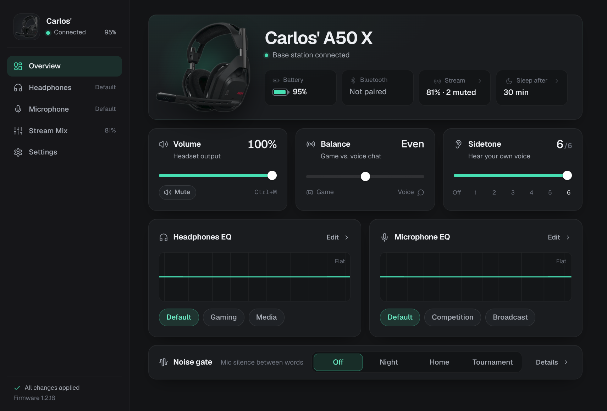

# logitech-manager

Control a **Logitech A50 X** headset without G Hub: a small library, a CLI (`a50x`) and a
desktop app, **Libre Hub**. The goal is Linux, where G Hub doesn't exist. Everything here also runs on
macOS. Both platforms have been verified against the real headset.



The protocol was reverse-engineered from G Hub and the device itself; see
[docs/PROTOCOL.md](docs/PROTOCOL.md) for the wire format and
[docs/GHUB-INTERNALS.md](docs/GHUB-INTERNALS.md) for how G Hub works and how this was
worked out.

## What it controls

| Setting | G Hub equivalent | Status |
|---|---|---|
| Sidetone (7 steps) | Settings → Sidetone | ✅ verified on hardware |
| Game ↔ voice balance (0..12) | Settings → Balance | ✅ verified on hardware |
| Device volume (0..21) and mute | Settings → Device Volume | ✅ verified on hardware |
| Sleep after (never / 15 / 30 / 60 min) | Settings → Power Management | ✅ verified, byte-identical to G Hub |
| Base station brightness (0..100) | Settings → Base Station Brightness | ✅ verified on hardware |
| Headset tones (none / all / minimal) | Settings → Tones | ✅ verified on hardware |
| Mic noise gate (off / home / night / tournament) | Microphone → Noise Gate | ✅ verified on hardware |
| Stream-port mix: output level/mute, mic / game / bluetooth / voice levels and mutes | Routing | ✅ verified on hardware |
| Headphones EQ: curated Default / Gaming / Media, custom presets, 10 bands | Headphones → Equalizer | ✅ verified on hardware |
| Mic EQ: curated Default / Competition / Broadcast, custom presets, 10 bands | Microphone → Equalizer | ✅ verified on hardware |
| Battery, firmware, serial, name, paired Bluetooth host | Settings | ✅ read-only |

**Mic volume:** G Hub has no mic-gain control for the A50 X. The mic level it exposes is
"Mic Out" in the stream-port mix (covered above). The level your apps record at is the
normal system input volume (PipeWire/PulseAudio/ALSA on Linux).

**Not covered:** renaming the headset, firmware updates, factory reset, mic test, and the
"EU power mode" capability, which G Hub lists but doesn't implement for this device.

## The app

- **Overview:** battery, Bluetooth, volume and mute (`Ctrl+M`), game/voice balance, sidetone,
  and one-click EQ presets and noise gate.
- **Headphones / Microphone:** a 10-band EQ you draw on directly. Drag a point, or focus it
  and use the arrow keys (Shift for 0.1 dB steps, double-click resets a band). Save curves as
  presets; deleting one can be undone.
- **Stream Mix:** a channel strip per source (mic, game, voice chat, Bluetooth) plus the
  output level, i.e. what the base station sends to a capture card or streaming PC. On Linux,
  with game and chat audio split, each strip has a live level meter (see below).
- **Settings:** sleep timer, headset tones, base station brightness, keeping your settings,
  start at login, and device details.

Every change applies immediately and is stored on the headset. Changes made on the headset
itself (such as its volume wheel) show up in the app as they happen. If the app can't reach
the headset it says why: base station not plugged in, no permission (with the udev commands
to copy), or the headset not answering. `Ctrl+1`…`Ctrl+5` switch pages.

## Tray, start at login and keeping your settings

Libre Hub lives in the system tray. The icon shows the battery, and its menu opens the window,
runs a settings check or quits. Closing the window keeps the app running there; to quit,
right-click the tray icon and choose **Quit Libre Hub**. Launching it again just brings the
window back. These options are on the **Settings** page:

- **Keep my headset settings.** If the headset's settings change while you weren't using the
  app (G Hub on Windows was known to reset sidetone and balance at boot), Libre Hub puts yours
  back. It checks when it starts, after the computer wakes, after you unlock (on Linux via
  logind's `LockedHint`), and whenever the headset reconnects. A check reads the headset,
  writes only the settings that differ, then reads again to confirm them. About 20 seconds
  later a follow-up check makes sure they stuck. A desktop notification tells you when
  something had to be restored. Everything is kept: sidetone, balance, volume, both EQs, noise
  gate, stream mix, sleep timer, tones and brightness.
- **Start when you log in.** Starts in the tray without opening the window, like G Hub. On
  Linux this writes an autostart entry in `~/.config/autostart/`, and on macOS a LaunchAgent.
  Both point at this checkout and are refreshed on every launch.

Turning "Keep" on saves what the headset has at that moment. After that, every change you make
in the app or with `a50x set` updates the saved settings, as do volume wheel changes while the
app runs. Changes made on the headset while the app isn't running count as drift and get put
back. Saved settings live in `restore.json` next to `presets.json`.

On Linux the app also installs `~/.local/share/applications/com.charlexmachina.LibreHub.desktop`.
That entry is what gives the window its name and icon (the Wayland app id), and it adds Libre Hub
to your application menu.

## Game and chat audio (Linux)

The base station has two playback devices, **Game** and **Voice**, which the headset's
Game/Voice balance mixes. PipeWire's default profile only exposes the Voice one, so on Linux
all desktop audio lands in the chat channel, and sliding the balance toward Game just turns
everything down.

**Settings → Game and chat audio → Split** (or `a50x audio setup`) fixes this for your user,
with no root needed:

- **A50 X Game** becomes the default output: games, browser, music.
- **A50 X Voice** gets voice-chat apps automatically: Discord (and Vesktop and similar
  clients), TeamSpeak, Mumble, Signal, Telegram, Zoom and others. Each app is routed the first
  time it plays; if you move it somewhere else in your sound settings, it stays there.
- **A50 X Mic** is the default input. **A50 X Stream Out** is the stream mix, ready to add to OBS.
- Your current volume carries over. Audio cuts out for about a second while WirePlumber
  restarts.

Under the hood it installs `linux/wireplumber/51-logitech-a50x.conf` into
`~/.config/wireplumber/wireplumber.conf.d/` and `logitech-a50x-chat.lua` into
`~/.local/share/wireplumber/scripts/`. The first switches the card to its Pro Audio profile and
names the devices; the second routes chat apps. It needs PipeWire with WirePlumber 0.5 or newer.
**Turn off** (or `a50x audio undo`) removes both files and puts the card back on its normal
profile.

### Live levels

With the split on, the app shows live levels, read from the devices above:

- **Stream Mix:** a meter beside each fader. Output reads **A50 X Stream Out**, which is what
  the stream gets. Mic reads **A50 X Mic**. Game and Voice chat read what this computer plays into
  **A50 X Game** and **A50 X Voice**, before the system volume and the strip's fader, so console
  audio doesn't show there. Bluetooth audio never reaches the computer, so it has no meter.
- **Microphone:** the last few seconds of your mic level under the noise-gate choices. A closed
  gate makes the headset send digital silence (measured: about −90 dBFS, against about −60 dBFS of
  room noise with the gate off), so the app can show when the gate is open or closed and stripe
  the silent stretches. G Hub doesn't expose the gate thresholds, so none are drawn; talk and
  compare the settings instead. Digital silence can also mean the mic is muted on the headset.

Levels are measured in the main process with `pw-record` and only the numbers reach the window.
Nothing is recorded or stored. Meters run only while their page is showing and the window is
focused, and **Turn off** keeps them off (on both pages) until you turn them back on. On the
test machine they use about 4% of one CPU core on Stream Mix and 5% on Microphone; nearly all of
it is Chromium drawing 30 frames a second (the desktop's compositor spends about 1% of a core more
showing them). Turned off or in the background they cost nothing, and with nothing moving almost
nothing.

## Requirements

- The **base station connected over USB.** Settings travel USB → base station →
  Lightspeed → headset. The headset's direct Bluetooth link carries audio only and can't
  be configured.
- To build from source: Node.js 20+. The repo pins Node 24 for [Volta](https://volta.sh) users.

## Install (Linux)

Download `Libre-Hub-x86_64.AppImage` from the
[latest release](https://github.com/CharlExMachina/LibreHub/releases/latest), put it
somewhere permanent (e.g. `~/Applications`), make it executable and run it:

```bash
chmod +x ~/Applications/Libre-Hub-x86_64.AppImage
~/Applications/Libre-Hub-x86_64.AppImage
```

It doesn't need FUSE 2. On first run it adds Libre Hub to your application menu. If it can't open
the base station yet, it shows the one-time udev command to copy (see below for what it does).

**Updates** install themselves. Libre Hub checks GitHub every few hours, downloads a new
release in the background, and installs it when you quit. To update right away, use
**Restart to update** in the tray menu or in Settings → Libre Hub. Keep the file's name as it is
so updates replace it in place.

## Build from source (Linux)

```bash
git clone git@github.com:CharlExMachina/LibreHub.git
cd LibreHub
npm ci

# let your desktop user open the base station's HID interface (once)
sudo cp linux/70-logitech-a50x.rules /etc/udev/rules.d/
sudo udevadm control --reload-rules && sudo udevadm trigger
# unplug and replug the base station
# (the rule must sort before systemd's 73-seat-late.rules, hence the 70- prefix)

npm run build
npm run cli -- status     # CLI
npm start                 # Electron app
npm run dist              # AppImage in release/
```

## CLI

```
a50x status [--json]
a50x set sidetone <0-6> | volume <0-21> | mute <on|off> | balance <0-12>
a50x set sleep <0|15|30|60> | brightness <0-100> | tones <none|all|minimal>
a50x set noise-gate <off|home|night|tournament>
a50x routing output <0-32> | output-mute <on|off> | <mic|game|bluetooth|voice> <0-32> | <input>-mute <on|off>
a50x eq <mic|headphones> [preset <name> | gains g1,...,g10]
a50x features | watch       (add --debug to see raw HID traffic)
a50x audio [status|setup|undo]   Linux: split game and chat audio (see above)
```

Run it with `npm run cli -- <args>`, or `npm link` to get `a50x` on your `PATH`. Custom EQ
presets created in the app are stored in Electron's user-data folder
(`~/.config/logitech-manager/presets.json` on Linux). The CLI reads the same file, so
`a50x eq headphones preset "<your preset>"` works too.

## Releasing

Versions follow [Semantic Versioning](https://semver.org), and `package.json` is the source of
truth. To release:

1. Add a `## X.Y.Z - date` section to [CHANGELOG.md](CHANGELOG.md). It becomes the release notes.
2. `npm version X.Y.Z` (or `patch` / `minor` / `major`). This bumps `package.json`, commits, and
   tags `vX.Y.Z`.
3. `git push --follow-tags`

The `release` workflow then checks that the tag matches `package.json`, runs the tests, builds
the AppImage and publishes the GitHub release with `latest-linux.yml`, the file the updater
reads. A tag with a suffix (e.g. `v1.1.0-beta.1`) is published as a pre-release, which
installed copies don't update to.

## Tests

```bash
npm test                 # unit + simulated-device tests (98), no hardware needed
npm run test:hardware    # 12 tests against a connected A50 X
```

- **Unit tests** decode and encode real frames captured from the headset
  (`test/fixtures/captures.ts`). Setters are checked to be byte-identical to writes the
  device accepted or G Hub produced.
- **Simulated device tests** run the client, the shared service layer used by the app and
  the CLI, and the preset store against a fake base station that speaks the captured
  byte layouts and error codes.
- **Hardware tests** read each setting, change it, check both the device's own change event
  and a fresh read, then restore the original and check that too. Quit G Hub first on
  macOS (it mirrors device events and can re-apply its own values). Expect brief audible
  changes to sidetone and volume.

### Verification status

- **macOS (Apple Silicon), firmware 1.2.18:** all 12 hardware tests pass. A full-state
  snapshot taken before matched one taken after, field for field. The Electron app was
  driven end to end over CDP (curated presets, sliders, saving, applying and deleting a
  custom preset), and every change was confirmed with independent HID reads.
- **Linux (CachyOS, kernel 7.2, KDE Plasma Wayland), firmware 1.2.18:** all 12 hardware
  tests pass, and a status read afterwards matched the one before. The app was driven end to
  end over CDP with real mouse and keyboard input: sliders, faders, mutes, noise gate,
  curated and custom EQ presets (save, apply, delete, undo). Every change was checked with a
  fresh read from the device, then restored. CI (Ubuntu) runs the unit/simulated tests.

## Layout

```
src/protocol/   framing (packet.ts), feature IDs, per-feature codecs, EQ codec
src/device/     node-hid transport + A50X client (discovery, request matching, events)
src/service.ts  snapshot + actions, shared by the app and the CLI
src/audio/      Linux game/chat audio split (WirePlumber setup, status, undo), live levels
src/presets/    custom EQ preset store (JSON)
src/restore/    keeping settings: compare, restore and verify; when to check; saved state
src/main/       Electron main process, sandboxed preload, tray, preferences, desktop entries
src/renderer/   UI: plain ES modules and CSS, no build step (fonts: Geist, OFL-1.1)
src/cli.ts      a50x command
test/           unit, simulated-device and hardware tests; fixtures are real captures
linux/          udev rule; WirePlumber rule and chat-routing script
build/          packaging resources (the 1024 px app icon)
docs/           protocol spec, G Hub internals and method, raw evidence
tools/re/       the scripts used for the reverse engineering
```
